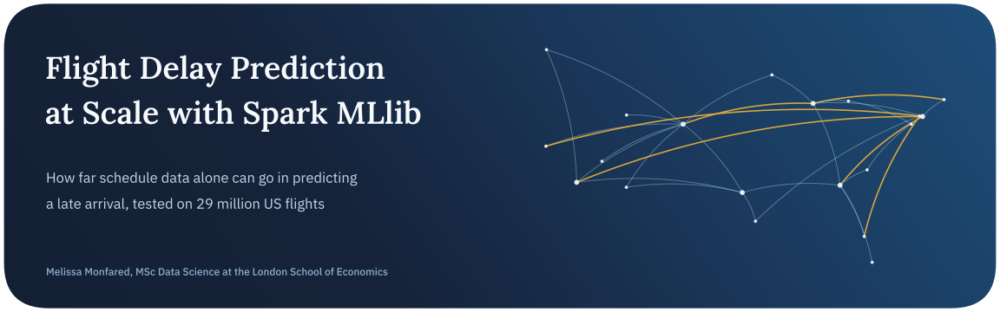
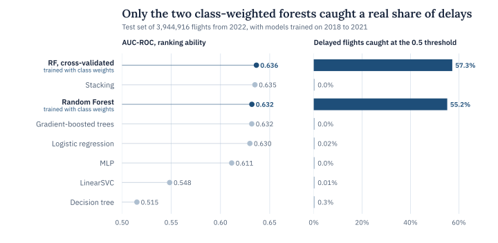
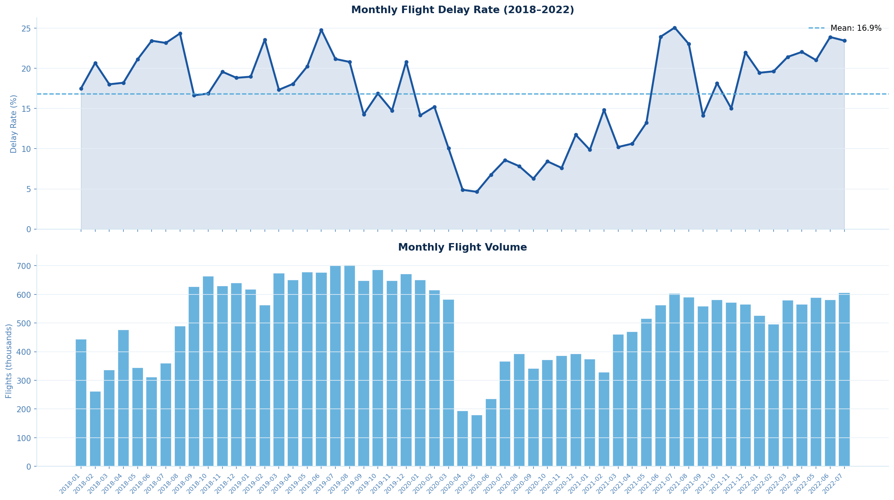
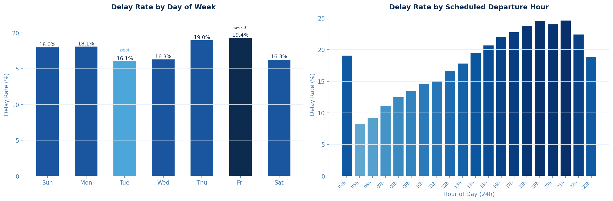
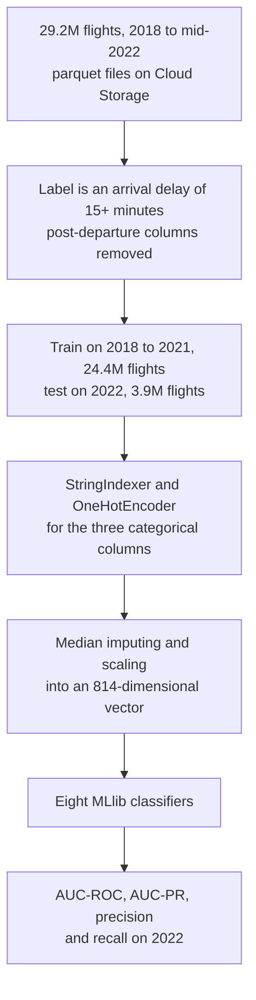
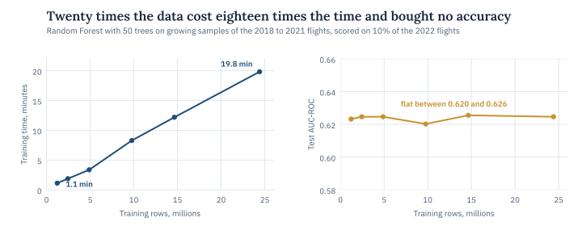

<p align="center">
  
</p>

<p align="center">
  
  
  
  
</p>

The FAA put the cost of US flight delays at about $33 billion for 2019, and a lot of that cost is easier to manage with some warning. This project asks whether a model can give that warning using only what is on the schedule before a flight leaves the gate.

I built the pipeline in PySpark on a Google Cloud Dataproc cluster, using 29.2 million domestic flights from 2018 to mid-2022. Eight MLlib classifiers, from logistic regression up to a cross-validated random forest, were trained on 2018 to 2021 and tested on 2022.

> **In short.** Schedule data alone sets a low ceiling. Every model’s AUC-ROC landed between 0.52 and 0.64, and twenty times more training data didn’t move it. What separated useful models from useless ones was class weighting. The two weighted random forests caught 55% to 57% of delayed flights, while the six unweighted models predicted on-time for almost every flight.

## Key findings

| Finding | Evidence |
| :-- | :-- |
| Schedule data alone has a low ceiling | Every model’s AUC-ROC on the 2022 flights fell between 0.52 and 0.64, with the cross-validated random forest on top at 0.6365 |
| Class weights decided which models were useful | The two weighted forests caught 55.2% and 57.3% of delayed flights at about 30% precision. The unweighted models caught 0.3% at most |
| Accuracy is the wrong yardstick here | Calling every flight on time scores 78.35% accuracy on 2022, and six of the eight models landed within 0.0001 of that |
| Time of day is the strongest single signal | Delay rates climb from about 8% for 5 am departures to about 25% in the evening, as late aircraft and crews knock on through the day |
| COVID broke the usual pattern | Monthly delay rates fell to about 5% in April and May 2020, and 2022 then ran at 21.6%, the highest year in the data |
| More data stopped helping early | Growing the training set twentyfold, from 1.2 million to 24.4 million flights, cost almost 18 times the time and left AUC-ROC flat between 0.620 and 0.626 |

<picture>
  <source media="(prefers-color-scheme: dark)" srcset="assets/results-dark.svg">
  
</picture>

## Conclusion

Scheduled information says something about delays, but not much. Knowing who flies a route and when lets the best model rank a delayed flight above an on-time one about 64% of the time, and it did no better on 24 million training flights than on 1.2 million. The missing signal is mostly weather and the state of the network on the day, which no schedule contains.

How a model was trained mattered more than which model it was. The two random forests were the only models given class weights, and they were the only ones that flagged delays at the default threshold, catching more than half of them. Most of the unweighted models ranked flights almost as well and then called nearly every flight on time.

In practice that points to a ranked risk score with a tuned threshold, fed with weather forecasts, rather than a yes or no at 0.5.

## The data

The data is the Flight Status Prediction dataset on Kaggle, built from US Bureau of Transportation Statistics records. It holds 29,193,782 domestic flights from January 2018 to July 2022 across 62 columns.

A flight counts as delayed when it arrives 15 or more minutes behind schedule, the official BTS definition. Flights with no recorded arrival delay, mostly cancellations and diversions, were removed, which leaves 28,347,599 flights, 17.7% of them delayed. Every feature comes from the schedule, so the models never see anything recorded after departure, such as taxi times or the actual departure and arrival times.



*Monthly delay rate and flight volume. The COVID collapse of 2020 shows up in both.*



*Delay rate by day of the week and by scheduled departure hour. Friday is the worst day and early morning the safest time to fly.*

Training uses 2018 to 2021 (24,402,683 flights) and testing uses 2022 (3,944,916), so no information from the future leaks into training. The 2022 test year also had the highest delay rate in the data, 21.6%.

## The pipeline



The features are the airline and the origin and destination airports, one-hot encoded, plus distance, scheduled flight time, month, day of week, scheduled departure and arrival hours and a few calendar flags such as summer and the holiday season.

| Model | Set-up | Class weights |
| :-- | :-- | :-- |
| Logistic regression | L2 penalty of 0.01, 20 iterations | No |
| Decision tree | Depth 8, at least 100 flights per leaf | No |
| Random forest | 50 trees of depth 8 | Yes, 4.56 on delayed flights |
| Gradient-boosted trees | 10 trees of depth 3, step size 0.1 | No |
| Stacking | Logistic regression on the forest and boosted-tree outputs | No |
| Random forest, cross-validated | 2-fold search over 50 or 100 trees and depth 8 or 12 on a 30% sample, best at 100 trees and depth 12 | Yes |
| MLP | Layers of 814, 16, 8 and 2 units, trained on a 30% sample | Not supported in MLlib |
| LinearSVC | L2 penalty of 0.01, 20 iterations | No |

<details>
<summary><b>Full test results for all eight models</b></summary>
<br>

| Model | AUC-ROC | AUC-PR | Precision | Recall | Training time |
| :-- | --: | --: | --: | --: | --: |
| Random forest, cross-validated | 0.6365 | 0.3192 | 29.8% | 57.3% | 67 min |
| Stacking | 0.6350 | 0.3150 | none flagged | 0.0% | 8 min |
| Random forest | 0.6319 | 0.3121 | 29.6% | 55.2% | 28 min |
| Gradient-boosted trees | 0.6318 | 0.3138 | none flagged | 0.0% | 49 min |
| Logistic regression | 0.6299 | 0.3101 | 45.5% | 0.02% | 3 min |
| MLP | 0.6114 | 0.2900 | none flagged | 0.0% | 10 min |
| LinearSVC | 0.5484 | 0.2447 | 30.0% | 0.01% | 2 min |
| Decision tree | 0.5151 | 0.2395 | 44.7% | 0.3% | 14 min |

Precision and recall are for the delayed class at the default 0.5 threshold. A model with no skill would score an AUC-PR of about 0.22, the share of delayed flights in 2022.

</details>

<picture>
  <source media="(prefers-color-scheme: dark)" srcset="assets/scaling-dark.svg">
  
</picture>

## Limitations and next steps

There is no weather data, and weather is the largest single cause of delays. Six of the eight models were trained without class weights and judged at the default 0.5 threshold, so their near-zero recall says more about the setup than about the algorithms. Only one test year was used, and it happened to be the worst year for delays in the data.

The notebook’s F1 column is Spark’s weighted F1, which rewards predicting the majority class, and its composite ranking builds on it. That is how logistic regression comes first there despite catching 131 of 853,962 delays, so this README reports recall, precision and AUC instead.

Next I’d join NOAA weather observations at both airports and give every model the same class weights. Tuning the decision threshold on a validation year would then show what each model can really do.

## Running it

The notebook ran on Google Cloud Dataproc with Spark 3.5.3 and 8 cores, reading the Kaggle parquet files from a Cloud Storage bucket. Training all eight models took about three hours there, over a third of it on the cross-validated forest. To run it yourself, download the Flight Status Prediction data from Kaggle and point the loading cell at your copy of the parquet files.

```bash
pip install pyspark==3.5.3 pandas numpy matplotlib seaborn plotly scikit-learn
jupyter notebook flight-delay-prediction-spark-mllib.ipynb
```

## Repository

```text
.
├── flight-delay-prediction-spark-mllib.ipynb   EDA, the Spark pipeline, all eight models and the scaling test
├── assets/                                     figures used in this README
└── README.md
```

## About

Made by Melissa Monfared, MSc Data Science at the London School of Economics. The project was originally built for ST446 Distributed Computing for Big Data at LSE. More projects live on [my website](https://melissamonfared.github.io). I also post notebooks on [Kaggle](https://kaggle.com/melissamonfared) and I’m on [LinkedIn](https://linkedin.com/in/melissamonfared).

Data from the Flight Status Prediction dataset on Kaggle, compiled from US Bureau of Transportation Statistics records.
